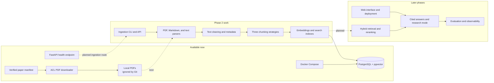

# NeuralNotes

NeuralNotes is a study and research workspace designed to make answers about technical documents traceable, measurable, and improvable. The long-term goal is to ingest papers and notes, retrieve relevant passages, and answer questions with citations that point back to their sources.

> **Project status — 3 November 2026:** the foundation and initial paper download are complete. Phase 2 ingestion is in progress. The initial pypdf adapter is implemented; its focused validation and the remaining ingestion steps are in progress.

## What works today

- A FastAPI application with a `/health` endpoint.
- Local PostgreSQL 16 with pgvector 0.8.7 through Docker Compose.
- A manifest of 30 ACL Anthology papers with license evidence recorded for each paper.
- A sequential downloader that checks manifest records and PDF responses before saving files under `data/raw/acl_anthology/`.
- pypdf is selected as the initial PDF parser; the comparison tool remains available to reproduce and extend the evaluation.
- An initial pypdf adapter implemented to return extracted text with one-based page numbers and basic title/author metadata; focused validation is pending.
- Unit tests, Ruff checks, pre-commit hooks, and a GitHub Actions workflow for lint and tests.

The 30 PDFs were downloaded successfully on 3 November 2026. They stay in Git-ignored local storage; the manifest and downloader are committed. The downloader's unit tests passed (41 tests). No retrieval or answer-quality metrics exist yet; those will be added with the evaluation harness.

## Architecture and current status

The diagram distinguishes available pieces from planned work. Docker Compose starts PostgreSQL, but the API does not connect to it yet.



## Run locally

### Requirements

- Windows with PowerShell
- Python 3.11 or 3.12
- Docker Desktop running
- Git

### Install and start the API

From a PowerShell terminal:

```powershell
git clone https://github.com/Arbaz-Parkar/NeuralNotes.git
cd NeuralNotes
py -3.11 -m venv .venv
.\.venv\Scripts\python.exe -m pip install -e ".[dev]"
docker compose up -d db
docker compose ps
```

Start the API:

```powershell
.\.venv\Scripts\python.exe -m uvicorn neuralnotes.api:app --reload
```

Open `http://127.0.0.1:8000/health` to check the health endpoint and `http://127.0.0.1:8000/docs` for the interactive API documentation.

### Download the paper corpus

In another PowerShell terminal from the repository directory:

```powershell
.\.venv\Scripts\python.exe -m neuralnotes.downloader
```

The downloader spaces requests, validates each response, and skips PDFs that are already present and valid. Downloaded papers are not committed to Git. The manifest is at [`data/manifest/papers.json`](data/manifest/papers.json); corpus sourcing and license checks are described in [ADR 002](docs/adr/002-corpus-source.md).

### Run checks

```powershell
.\.venv\Scripts\python.exe -m pytest
.\.venv\Scripts\ruff.exe check src tests
.\.venv\Scripts\ruff.exe format --check src tests
```

## Current work and next steps

Phase 2 is building the ingestion path. In one run, pypdf was faster and emitted about twice as many whitespace-separated words as pdfplumber's default mode. A visual check of the first paper found its spacing more readable. pypdf is the initial choice, with the limits of this small comparison recorded in [ADR 003](docs/adr/003-pdf-parser.md) and the [comparison notes](docs/parser_comparison.md). The parser adapter is in place; the next task is to validate it and then add text cleaning.

Not implemented yet: Markdown and plain-text parsers, text cleaning, chunking, embeddings, database persistence, BM25 or vector retrieval, answer generation, evaluations, web UI, and deployment. There is no demo recording or measured RAG result yet.

As the project progresses, this README will be updated with verified features, setup changes, real screenshots, measured evaluation results, limitations, and lessons from experiments. Progress and decisions are tracked in the [development log](docs/devlog.md).

## Design notes

- **Corpus source:** ACL Anthology papers are included only when the official paper page provides license evidence. See [ADR 002](docs/adr/002-corpus-source.md).
- **Local data:** PDFs and generated artifacts stay outside version control.
- **Evaluation:** quality claims will be added only after the project has a verified evaluation set and reports real metrics with uncertainty estimates.

## References

- [ACL Anthology](https://aclanthology.org/)
- [Project implementation brief](Project.md)
- [Development log](docs/devlog.md)
