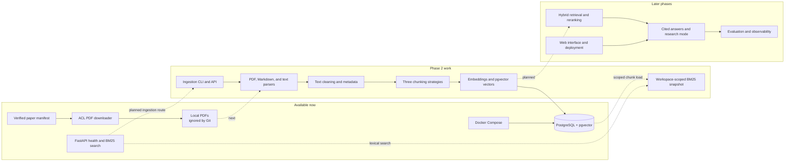

# NeuralNotes

NeuralNotes is a study and research workspace designed to make answers about technical documents traceable, measurable, and improvable. The long-term goal is to ingest papers and notes, retrieve relevant passages, and answer questions with citations that point back to their sources.

> **Project status — 7 November 2026:** the foundation and initial paper download are complete. Phase 2 ingestion is in progress. PDF, Markdown, and plain-text parsers, three chunking strategies, tokenizer and embedding adapters, workspace-scoped persistence, content-addressed embedding caching, and an initial BM25 search API are implemented. Single-paper ingestion stored the 13-page DPR paper with 181 chunks. A two-paper batch smoke test stored 424 chunks across 32 pages with zero failures; 19 focused tests and both Ruff checks passed. The API, BM25 adapter, and core test run passed 19 tests; Ruff import-order and formatting fixes are applied, with checks pending rerun.

## What works today

- A FastAPI application with a `/health` endpoint.
- Local PostgreSQL 16 with pgvector 0.8.7 through Docker Compose.
- A manifest of 30 ACL Anthology papers with license evidence recorded for each paper.
- A sequential downloader that checks manifest records and PDF responses before saving files under `data/raw/acl_anthology/`.
- pypdf is selected as the initial PDF parser; the comparison tool remains available to reproduce and extend the evaluation.
- A pypdf adapter that returns extracted text with one-based page numbers and basic title/author metadata; 4 unit tests pass, and it has read a local 13-page paper.
- A plain-text parser adapter that reads UTF-8 files as one page and preserves the source text and line endings; its tests passed in the latest 36-test focused run.
- A Markdown parser adapter that preserves the source as one page and extracts the first level-one heading outside fenced code blocks as the title; its tests passed in the latest 36-test focused run.
- A pure text cleaner that normalizes whitespace, removes explicit soft hyphens across wrapped words, and retains page boundaries; it removes numeric footer lines only when they form a consistent sequence across at least 80% of pages and at least three pages. Its 9 focused tests passed in the latest 36-test run.
- A local audit tool that reports recurring lines near page tops and bottoms for manual review; the latest corpus run produced 81 candidates after numeric-only page numbers were excluded. The audit does not remove text.
- An immutable chunk data model and fixed-size chunker with overlap, page boundaries, character offsets, and stable ids. Its provisional default is 100 tokens with 20 tokens of overlap, based on the selected embedding model's sequence-length guidance; this has not been tuned. `HuggingFaceOffsetTokenizer` supplies fast-tokenizer character offsets.
- A recursive chunker uses the same tokenizer and size/overlap settings while preferring paragraph, line, sentence, and whitespace boundaries. Its tests passed as part of a 25-test focused run, and Ruff lint and formatting checks passed.
- A sentence-window chunker creates sentence-centered chunks and adds neighboring sentences when they fit within the token cap. Oversized sentences are split into bounded pieces; punctuation-based sentence detection has a small abbreviation list and remains heuristic. Its focused tests and Ruff checks passed before commit `b85129d`.
- A SQLite embedding cache keys vectors by model name, embedding type, and a SHA-256 hash of exact input text. The ingestion CLI uses the cache at the ignored `data/cache/embeddings.sqlite3` path, so repeat imports reuse embeddings without storing source text in the cache. Its focused tests and Ruff checks passed before commit `90198cf`.
- An in-memory BM25 core builds an inverted term-frequency index over existing `Chunk` objects and returns deterministic top-k results. It uses case-folded Unicode word tokens and configurable `k1`/`b` parameters. A SQLAlchemy adapter builds an index from rows filtered to one workspace. The combined BM25 and adapter test run passed all 16 tests; an import-order fix was applied and Ruff lint rerun is pending. Retrieval quality has not been measured; see [complexity notes](docs/complexity_notes.md).
- `POST /v1/search` accepts a workspace id, query, and top-k limit, then returns matching passages with chunk ids, page numbers, character offsets, and BM25 scores. The database session is scoped to the request, and the index loads only the requested workspace's chunks. Its API, adapter, and core tests passed (19 total). Ruff import-order and formatting fixes are applied; checks are pending rerun. This route returns passages only; answer generation and authentication are not implemented yet.
- The initial local English embedding baseline is `sentence-transformers/all-MiniLM-L6-v2` (384 dimensions). Its fast tokenizer adapter passed 10 focused unit tests and returned character spans from a real tokenizer call. The lazy Sentence Transformers adapter passed 14 focused unit tests; a real CPU smoke check returned 384-dimensional document and query vectors with unit norm. Install the pinned optional dependency with `pip install -e ".[dev,embeddings]"`. This is a starting point for later measured comparison, not a proven best model.
- A document-preparation pipeline composes parsing, page-preserving cleaning, fixed-size chunking, and batched embeddings in memory. A SQLAlchemy persistence adapter stores its metadata and chunks under one workspace-scoped transaction, computes a SHA-256 source hash, and replaces prior chunks on repeat imports. Persistence and pipeline unit tests passed in the latest 12-test focused run.
- A single-paper ingestion CLI selects a license-checked manifest record, reads its already-downloaded PDF, runs the local parser/chunker/embedder pipeline, creates a default workspace if needed, and stores document/license metadata and chunks in one transaction. It uses the `all-MiniLM-L6-v2` model on CPU in the current environment. Its smoke check stored the 13-page DPR paper as 181 chunks.
- SQLAlchemy models and Alembic migrations define workspace-scoped documents and chunks. Chunk rows retain page and character provenance, strategy and model metadata, and 384-dimensional vectors with a cosine HNSW index. The local PostgreSQL migration was applied for the ingestion smoke check, and a query confirmed the document is `ready` with 181 chunks. See [ADR 005](docs/adr/005-database-connectivity.md), [ADR 006](docs/adr/006-document-schema.md), and [ADR 007](docs/adr/007-pgvector-chunk-storage.md).
- Unit tests, Ruff checks, pre-commit hooks, and a GitHub Actions workflow for lint and tests.

The 30 PDFs were downloaded successfully on 3 November 2026. They stay in Git-ignored local storage; the manifest and downloader are committed. The downloader's unit tests passed (41 tests). No retrieval or answer-quality metrics exist yet; those will be added with the evaluation harness.

## Architecture and current status

The diagram distinguishes available pieces from planned work. The API uses PostgreSQL for workspace-scoped lexical search; ingestion still runs through the CLI.



## Run locally

### Requirements

- Windows with PowerShell
- Python 3.11 or 3.12
- Docker Desktop running
- Git

### Install and start the API

From a PowerShell terminal:

```powershell
git clone https://github.com/Arbaz-Parkar/NeuralNotes.git
cd NeuralNotes
py -3.11 -m venv .venv
.\.venv\Scripts\python.exe -m pip install -e ".[dev]"
docker compose up -d db
docker compose ps
.\.venv\Scripts\python.exe -c "from neuralnotes.database import check_database_connection, create_database_engine; engine = create_database_engine(); check_database_connection(engine); print('database connection: ok'); engine.dispose()"
.\.venv\Scripts\alembic.exe upgrade head
```

Start the API:

```powershell
.\.venv\Scripts\python.exe -m uvicorn neuralnotes.api:app --reload
```

Open `http://127.0.0.1:8000/health` to check the health endpoint and `http://127.0.0.1:8000/docs` for the interactive API documentation.

With the local papers ingested, search the default workspace from another PowerShell terminal:

```powershell
$searchBody = @{ workspace_id = "11111111-1111-4111-8111-111111111111"; query = "dense passage retrieval"; top_k = 3 } | ConvertTo-Json
Invoke-RestMethod -Uri "http://127.0.0.1:8000/v1/search" -Method Post -ContentType "application/json" -Body $searchBody
```

### Install the optional embedding dependency

The local embedding stack is optional because it adds PyTorch and other model dependencies. Install the pinned extra to load the tokenizer and create embeddings:

```powershell
.\.venv\Scripts\python.exe -m pip install -e ".[dev,embeddings]"
.\.venv\Scripts\python.exe -c "import torch, sentence_transformers; print('sentence-transformers', sentence_transformers.__version__); print('CUDA available:', torch.cuda.is_available())"
```

The selected model is `sentence-transformers/all-MiniLM-L6-v2`. See [ADR 004](docs/adr/004-embedding-model.md) for the choice and its limits. The current Windows environment reports CUDA unavailable, and the tokenizer check ran on CPU. GPU acceleration depends on installing a compatible CUDA-enabled PyTorch build.

### Download the paper corpus

In another PowerShell terminal from the repository directory:

```powershell
.\.venv\Scripts\python.exe -m neuralnotes.downloader
```

The downloader spaces requests, validates each response, and skips PDFs that are already present and valid. Downloaded papers are not committed to Git. The manifest is at [`data/manifest/papers.json`](data/manifest/papers.json); corpus sourcing and license checks are described in [ADR 002](docs/adr/002-corpus-source.md).

### Ingest one paper

After installing the embedding extra, starting PostgreSQL, applying the migrations, and downloading the corpus, ingest one paper by its ACL Anthology ID:

```powershell
.\.venv\Scripts\python.exe -m neuralnotes.ingestion.cli --paper-id 2020.emnlp-main.550
```

The command creates a default local workspace on its first run. Use `--workspace-id` and `--workspace-name` to target a different workspace. The first run may load model files from Hugging Face; subsequent runs use the local model cache and reuse vectors for known text. Re-ingesting the same source in the same workspace replaces its existing chunks.

Ingest several selected manifest papers in one run by repeating `--paper-id`, or process the full manifest with `--all`:

```powershell
.\.venv\Scripts\python.exe -m neuralnotes.ingestion.cli --paper-id 2020.emnlp-main.550 --paper-id 2024.emnlp-main.845
.\.venv\Scripts\python.exe -m neuralnotes.ingestion.cli --all
```

Batch mode reuses the parser, embedding model, cache, and database engine across papers. It commits each paper separately, reports failures, and continues with the remaining sources. It returns a nonzero exit code if any paper fails. A two-paper local smoke test ingested 2020.emnlp-main.550 (13 pages, 181 chunks) and 2024.emnlp-main.845 (19 pages, 243 chunks).

### Audit repeated page margins

After downloading the corpus, run the local audit:

```powershell
.\.venv\Scripts\python.exe -m neuralnotes.margin_audit
```

It writes candidate repeated top and bottom lines to the ignored `data/processed/margin_candidates.csv` file. Candidates need manual review; the audit does not remove text.

### Run checks

```powershell
.\.venv\Scripts\python.exe -m pytest
.\.venv\Scripts\ruff.exe check src tests
.\.venv\Scripts\ruff.exe format --check src tests
```

## Current work and next steps

The corpus scan found 8,469 hard-hyphen line-break candidates. The sample includes word wraps such as `us- / ing` and legitimate compounds such as `dual- / encoder`; hard hyphens therefore remain unchanged until a reliable lexical check is available.

Phase 2 is building the ingestion and indexing path. In one run, pypdf was faster and emitted about twice as many whitespace-separated words as pdfplumber's default mode. A visual check of the first paper found its spacing more readable. pypdf is the initial choice, with the limits of this small comparison recorded in [ADR 003](docs/adr/003-pdf-parser.md) and the [comparison notes](docs/parser_comparison.md). The adapter read the 13-page DPR paper and returned 56,093 characters. The whitespace cleaner passed 5 focused tests; its application to that paper also returned 56,093 characters, so it made no net character-count change on this sample. Review of the first margin report found that varying numeric-only printed page numbers were grouped into one candidate. The audit now skips numeric-only margin lines and produced 81 candidates on the latest corpus run. Repeated table headings and captions were confirmed as document content. Sequential numeric page-footer cleanup passed 8 focused tests and Ruff; a sample check confirmed printed numbers were removed from pages 1–3 and 35–36 of a 36-page paper while retaining page text. The initial embedding baseline is `all-MiniLM-L6-v2`, with a provisional 100-token chunk and 20-token overlap; no embedding quality or speed comparison has been run. The BM25 core and workspace adapter passed 16 focused tests, and `POST /v1/search` now returns workspace-scoped lexical results; API validation is pending.

Not implemented yet: general repeated header/footer removal, hard-hyphen line-break handling, API ingestion, vector retrieval and hybrid ranking, answer generation, evaluations, web UI, and deployment. The BM25 workspace index is an in-memory snapshot that must be rebuilt after workspace documents change. There is no demo recording or measured RAG result yet.

As the project progresses, this README will be updated with verified features, setup changes, real screenshots, measured evaluation results, limitations, and lessons from experiments. Progress and decisions are tracked in the [development log](docs/devlog.md).

## Design notes

- **Corpus source:** ACL Anthology papers are included only when the official paper page provides license evidence. See [ADR 002](docs/adr/002-corpus-source.md).
- **Local data:** PDFs and generated artifacts stay outside version control.
- **Evaluation:** quality claims will be added only after the project has a verified evaluation set and reports real metrics with uncertainty estimates.

## References

- [ACL Anthology](https://aclanthology.org/)
- [Project implementation brief](Project.md)
- [Development log](docs/devlog.md)
