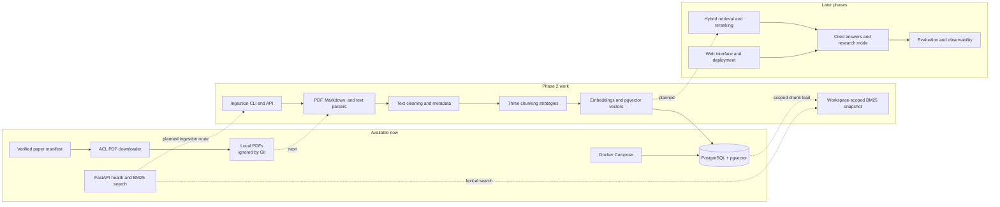

# NeuralNotes

NeuralNotes is a study and research workspace designed to make answers about technical documents traceable, measurable, and improvable. The long-term goal is to ingest papers and notes, retrieve relevant passages, and answer questions with citations that point back to their sources.

> **Project status — 16 November 2026:** ingestion, workspace-scoped retrieval, and the retrieval evaluation harness are implemented. The verified set contains 56 answerable development questions and 18 answerable test questions, plus six unanswerable questions in each split. Phase 5 compared chunking, BM25/RRF parameters, dense embeddings, reranking, pseudo-relevance feedback, and a LangChain BM25 baseline. In-house BM25 remains the default; the results and limitations are recorded in [ADR 008](docs/adr/008-retrieval-defaults.md) and the [ablation report](docs/experiments/ablation_study.md). The benchmark is still small and drawn from a narrow paper corpus. Answer generation, citation validation, the web UI, and deployment remain future work.

## What works today

- A FastAPI application with a `/health` endpoint.
- Local PostgreSQL 16 with pgvector 0.8.7 through Docker Compose.
- A manifest of 30 ACL Anthology papers with license evidence recorded for each paper.
- A sequential downloader that checks manifest records and PDF responses before saving files under `data/raw/acl_anthology/`.
- pypdf is selected as the initial PDF parser; the comparison tool remains available to reproduce and extend the evaluation.
- A pypdf adapter that returns extracted text with one-based page numbers and basic title/author metadata; 4 unit tests pass, and it has read a local 13-page paper.
- A plain-text parser adapter that reads UTF-8 files as one page and preserves the source text and line endings; its tests passed in the latest 36-test focused run.
- A Markdown parser adapter that preserves the source as one page and extracts the first level-one heading outside fenced code blocks as the title; its tests passed in the latest 36-test focused run.
- A pure text cleaner that normalizes whitespace, removes explicit soft hyphens across wrapped words, and retains page boundaries; it removes numeric footer lines only when they form a consistent sequence across at least 80% of pages and at least three pages. Its 9 focused tests passed in the latest 36-test run.
- A local audit tool that reports recurring lines near page tops and bottoms for manual review; the latest corpus run produced 81 candidates after numeric-only page numbers were excluded. The audit does not remove text.
- An immutable chunk data model and fixed-size chunker with overlap, page boundaries, character offsets, and stable ids. Its provisional default is 100 tokens with 20 tokens of overlap, based on the selected embedding model's sequence-length guidance; this has not been tuned. `HuggingFaceOffsetTokenizer` supplies fast-tokenizer character offsets.
- A recursive chunker uses the same tokenizer and size/overlap settings while preferring paragraph, line, sentence, and whitespace boundaries. Its tests passed as part of a 25-test focused run, and Ruff lint and formatting checks passed.
- A sentence-window chunker creates sentence-centered chunks and adds neighboring sentences when they fit within the token cap. Oversized sentences are split into bounded pieces; punctuation-based sentence detection has a small abbreviation list and remains heuristic. Its focused tests and Ruff checks passed before commit `b85129d`.
- A SQLite embedding cache keys vectors by model name, embedding type, and a SHA-256 hash of exact input text. The ingestion CLI uses the cache at the ignored `data/cache/embeddings.sqlite3` path, so repeat imports reuse embeddings without storing source text in the cache. Its focused tests and Ruff checks passed before commit `90198cf`.
- An in-memory BM25 core builds an inverted term-frequency index over `Chunk` objects and returns deterministic top-k results. It uses case-folded Unicode word tokens and configurable `k1`/`b` parameters. The SQLAlchemy adapter filters rows to one workspace. Retrieval metrics and measured trade-offs are documented in the [Phase 5 ablation report](docs/experiments/ablation_study.md); BM25 remains the default per [ADR 008](docs/adr/008-retrieval-defaults.md).
- `POST /v1/search` accepts a workspace id, query, and top-k limit, then returns matching passages with chunk ids, page numbers, character offsets, and BM25 scores. The database session is request-scoped, and the index loads only the requested workspace's chunks. This endpoint returns passages; grounded answer generation and citation validation are not implemented yet.
- The initial local English embedding baseline is `sentence-transformers/all-MiniLM-L6-v2` (384 dimensions). Its fast tokenizer adapter passed 10 focused unit tests and returned character spans from a real tokenizer call. The lazy Sentence Transformers adapter passed 14 focused unit tests; a real CPU smoke check returned 384-dimensional document and query vectors with unit norm. Install the pinned optional dependency with `pip install -e ".[dev,embeddings]"`. This is a starting point for later measured comparison, not a proven best model.
- A document-preparation pipeline composes parsing, page-preserving cleaning, fixed-size chunking, and batched embeddings in memory. A SQLAlchemy persistence adapter stores its metadata and chunks under one workspace-scoped transaction, computes a SHA-256 source hash, and replaces prior chunks on repeat imports. Persistence and pipeline unit tests passed in the latest 12-test focused run.
- A single-paper ingestion CLI selects a license-checked manifest record, reads its already-downloaded PDF, runs the local parser/chunker/embedder pipeline, creates a default workspace if needed, and stores document/license metadata and chunks in one transaction. It uses the `all-MiniLM-L6-v2` model on CPU in the current environment. Its smoke check stored the 13-page DPR paper as 181 chunks.
- The ingestion CLI can select `fixed_size`, `recursive`, or `sentence_window` chunking with `--chunking-strategy`; `fixed_size` remains the default. A separate workspace per strategy preserves each version of the same source for comparison. All 14 focused ingestion, batch, and statistics tests passed.
- `python -m neuralnotes.ingestion.stats --workspace-id <UUID>` reports ready-document and chunk counts, chunks by strategy, and min/median/95th-percentile/mean/max token counts. It can print Markdown or save it with `--output`. Two report tests passed, and reports were generated for the three sample workspaces.
- `neuralnotes.retrieval.metrics` implements Precision@k, Recall@k, HitRate@k, ReciprocalRank@k, and binary nDCG@k. All 12 focused tests and Ruff checks passed before commit `13ef3ad`. Thirty-five verified questions across five papers provide a small development set; a larger benchmark and held-out test results do not exist yet.
- `neuralnotes.evaluation` validates JSONL questions, enforces dev/test split separation, maps document/page character-span evidence to relevant chunks, and reports ranking metrics with seeded bootstrap intervals. The committed dataset currently contains 56 answerable dev cases and 18 answerable test cases, with six unanswerable cases per split.
- `python -m neuralnotes.evaluation.cli` supports BM25, dense-only, and hybrid BM25+dense RRF evaluation, optional cross-encoder reranking, and BM25 pseudo-relevance feedback. Versioned JSON/Markdown reports include per-query metrics and latency; paired comparisons calculate candidate-minus-baseline intervals. The measured results remain exploratory because the corpus and test sample are small.
- `python -m neuralnotes.evaluation.comparison` pairs two run reports by query id and writes candidate-minus-baseline bootstrap intervals. It rejects mismatched dataset versions, splits, cutoffs, or query sets. The 45 evaluation/comparison tests passed; a follow-up compatibility fix accepts the report's `relevant_chunk_count` field, and its 7 focused tests, Ruff lint, and format checks passed. The five-question pilot is too small for quality claims.
- `python -m neuralnotes.evaluation.inspect_source --paper-id <ACL_ID> --page-number <PAGE>` displays a cleaned PDF page with zero-based, end-exclusive offsets matching stored chunks. It supports manual evidence labeling without writing extracted paper text into the repository. See [the labeling guide](docs/evaluation_labeling.md); the verified dataset still needs many more cases and a held-out test split.
- SQLAlchemy models and Alembic migrations define workspace-scoped documents and chunks. Chunk rows retain page and character provenance, strategy and model metadata, and 384-dimensional vectors with a cosine HNSW index. The local PostgreSQL migration was applied for the ingestion smoke check, and a query confirmed the document is `ready` with 181 chunks. See [ADR 005](docs/adr/005-database-connectivity.md), [ADR 006](docs/adr/006-document-schema.md), and [ADR 007](docs/adr/007-pgvector-chunk-storage.md).
- Unit tests, Ruff checks, pre-commit hooks, and a GitHub Actions workflow for lint and tests.

The 30 PDFs were downloaded successfully on 3 November 2026. They stay in Git-ignored local storage; the manifest and downloader are committed. The downloader's unit tests passed (41 tests). Five manually checked development questions now exercise the BM25 evaluation and paired-comparison pipeline across three chunking workspaces; this smoke run is not retrieval-quality evidence.

## Architecture and current status

The diagram distinguishes available pieces from planned work. The API uses PostgreSQL for workspace-scoped lexical search; ingestion still runs through the CLI.



## Run locally

### Requirements

- Windows with PowerShell
- Python 3.11 or 3.12
- Docker Desktop running
- Git

### Install and start the API

From a PowerShell terminal:

```powershell
git clone https://github.com/Arbaz-Parkar/NeuralNotes.git
cd NeuralNotes
py -3.11 -m venv .venv
.\.venv\Scripts\python.exe -m pip install -e ".[dev]"
docker compose up -d db
docker compose ps
.\.venv\Scripts\python.exe -c "from neuralnotes.database import check_database_connection, create_database_engine; engine = create_database_engine(); check_database_connection(engine); print('database connection: ok'); engine.dispose()"
.\.venv\Scripts\alembic.exe upgrade head
```

Start the API:

```powershell
.\.venv\Scripts\python.exe -m uvicorn neuralnotes.api:app --reload
```

Open `http://127.0.0.1:8000/health` to check the health endpoint and `http://127.0.0.1:8000/docs` for the interactive API documentation.

With the local papers ingested, search the default workspace from another PowerShell terminal:

```powershell
$searchBody = @{ workspace_id = "11111111-1111-4111-8111-111111111111"; query = "dense passage retrieval"; top_k = 3 } | ConvertTo-Json
Invoke-RestMethod -Uri "http://127.0.0.1:8000/v1/search" -Method Post -ContentType "application/json" -Body $searchBody
```

### Install the optional embedding dependency

The local embedding stack is optional because it adds PyTorch and other model dependencies. Install the pinned extra to load the tokenizer and create embeddings:

```powershell
.\.venv\Scripts\python.exe -m pip install -e ".[dev,embeddings]"
.\.venv\Scripts\python.exe -c "import torch, sentence_transformers; print('sentence-transformers', sentence_transformers.__version__); print('CUDA available:', torch.cuda.is_available())"
```

The selected model is `sentence-transformers/all-MiniLM-L6-v2`. See [ADR 004](docs/adr/004-embedding-model.md) for the choice and its limits. The current Windows environment reports CUDA unavailable, and the tokenizer check ran on CPU. GPU acceleration depends on installing a compatible CUDA-enabled PyTorch build.

### Download the paper corpus

In another PowerShell terminal from the repository directory:

```powershell
.\.venv\Scripts\python.exe -m neuralnotes.downloader
```

The downloader spaces requests, validates each response, and skips PDFs that are already present and valid. Downloaded papers are not committed to Git. The manifest is at [`data/manifest/papers.json`](data/manifest/papers.json); corpus sourcing and license checks are described in [ADR 002](docs/adr/002-corpus-source.md).

### Ingest one paper

After installing the embedding extra, starting PostgreSQL, applying the migrations, and downloading the corpus, ingest one paper by its ACL Anthology ID:

```powershell
.\.venv\Scripts\python.exe -m neuralnotes.ingestion.cli --paper-id 2020.emnlp-main.550
```

The command creates a default local workspace on its first run. Use `--workspace-id` and `--workspace-name` to target a different workspace. The first run may load model files from Hugging Face; subsequent runs use the local model cache and reuse vectors for known text. Re-ingesting the same source in the same workspace replaces its existing chunks.

Ingest several selected manifest papers in one run by repeating `--paper-id`, or process the full manifest with `--all`:

```powershell
.\.venv\Scripts\python.exe -m neuralnotes.ingestion.cli --paper-id 2020.emnlp-main.550 --paper-id 2024.emnlp-main.845
.\.venv\Scripts\python.exe -m neuralnotes.ingestion.cli --all
```

Batch mode reuses the parser, embedding model, cache, and database engine across papers. It commits each paper separately, reports failures, and continues with the remaining sources. It returns a nonzero exit code if any paper fails. A two-paper local smoke test ingested 2020.emnlp-main.550 (13 pages, 181 chunks) and 2024.emnlp-main.845 (19 pages, 243 chunks).

Choose a chunking strategy for an ingestion run with `--chunking-strategy`. The default is `fixed_size`; `recursive` and `sentence_window` use the same 100-token ceiling with their respective boundary rules. Use separate workspace ids when comparing strategies so that reingesting a document does not replace the prior strategy's chunks:

```powershell
.\.venv\Scripts\python.exe -m neuralnotes.ingestion.cli --paper-id 2020.emnlp-main.550 --workspace-id 22222222-2222-4222-8222-222222222222 --workspace-name "Recursive experiment" --chunking-strategy recursive
.\.venv\Scripts\python.exe -m neuralnotes.ingestion.cli --paper-id 2020.emnlp-main.550 --workspace-id 33333333-3333-4333-8333-333333333333 --workspace-name "Sentence window experiment" --chunking-strategy sentence_window
```

Generate workspace-level ingestion statistics after ingesting documents:

```powershell
.\.venv\Scripts\python.exe -m neuralnotes.ingestion.stats --workspace-id 11111111-1111-4111-8111-111111111111 --output data/processed/ingestion_statistics.md
```

### Audit repeated page margins

After downloading the corpus, run the local audit:

```powershell
.\.venv\Scripts\python.exe -m neuralnotes.margin_audit
```

It writes candidate repeated top and bottom lines to the ignored `data/processed/margin_candidates.csv` file. Candidates need manual review; the audit does not remove text.

### Run checks

```powershell
.\.venv\Scripts\python.exe -m pytest
.\.venv\Scripts\ruff.exe check src tests
.\.venv\Scripts\ruff.exe format --check src tests
```

## Current work and next steps

Phase 5 retrieval comparisons are recorded in the [ablation report](docs/experiments/ablation_study.md). In-house BM25 with the established `k1=1.5` and `b=0.75` remains the default. Dense-only BGE showed a positive nDCG@10 interval against MiniLM on the 18-query test comparison, while MRR@10 and Recall@10 intervals included zero; MiniLM remains the default pending broader corpus coverage. Reranking, hybrid retrieval, query expansion, and LangChain BM25 remain optional evaluation paths.

Next: build a grounded answer-generation path that uses retrieved passages, validates citations against their source spans, and abstains when the evidence is insufficient. Keep the generation provider behind an interface so provider selection does not change retrieval or citation validation.

Not implemented yet: answer generation, citation validation, API ingestion, a web UI, and deployment. Dense and hybrid retrieval are available in the evaluation CLI but are not served by the `/v1/search` endpoint. The BM25 workspace index is an in-memory snapshot that must be rebuilt after workspace documents change. The current benchmark remains narrow and does not support broad quality claims.

As the project progresses, this README will be updated with verified features, setup changes, real screenshots, measured evaluation results, limitations, and lessons from experiments. Progress and decisions are tracked in the [development log](docs/devlog.md).

## Design notes

- **Corpus source:** ACL Anthology papers are included only when the official paper page provides license evidence. See [ADR 002](docs/adr/002-corpus-source.md).
- **Local data:** PDFs and generated artifacts stay outside version control.
- **Evaluation:** quality claims will be added only after the project has a verified evaluation set and reports real metrics with uncertainty estimates.

## References

- [ACL Anthology](https://aclanthology.org/)
- [Project implementation brief](Project.md)
- [Development log](docs/devlog.md)
