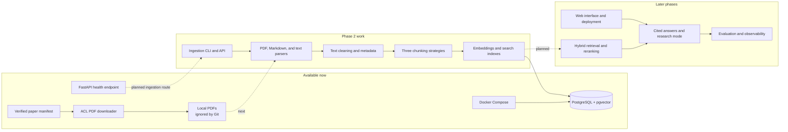

# NeuralNotes

NeuralNotes is a study and research workspace designed to make answers about technical documents traceable, measurable, and improvable. The long-term goal is to ingest papers and notes, retrieve relevant passages, and answer questions with citations that point back to their sources.

> **Project status — 4 November 2026:** the foundation and initial paper download are complete. Phase 2 ingestion is in progress. PDF and plain-text adapters are present; the Markdown parser has been added for validation. The corpus audit produced 81 candidates for manual review. The initial embedding baseline is selected, but its tokenizer and embedding adapter are not wired yet.

## What works today

- A FastAPI application with a `/health` endpoint.
- Local PostgreSQL 16 with pgvector 0.8.7 through Docker Compose.
- A manifest of 30 ACL Anthology papers with license evidence recorded for each paper.
- A sequential downloader that checks manifest records and PDF responses before saving files under `data/raw/acl_anthology/`.
- pypdf is selected as the initial PDF parser; the comparison tool remains available to reproduce and extend the evaluation.
- A pypdf adapter that returns extracted text with one-based page numbers and basic title/author metadata; 4 unit tests pass, and it has read a local 13-page paper.
- A plain-text parser adapter that reads UTF-8 files as one page and preserves the source text and line endings; its tests passed in the latest 36-test focused run.
- A Markdown parser adapter that preserves the source as one page and extracts the first level-one heading outside fenced code blocks as the title; its tests passed in the latest 36-test focused run.
- A pure text cleaner that normalizes whitespace, removes explicit soft hyphens across wrapped words, and retains page boundaries; it removes numeric footer lines only when they form a consistent sequence across at least 80% of pages and at least three pages. Its 9 focused tests passed in the latest 36-test run.
- A local audit tool that reports recurring lines near page tops and bottoms for manual review; the latest corpus run produced 81 candidates after numeric-only page numbers were excluded. The audit does not remove text.
- An immutable chunk data model and fixed-size chunker with overlap, page boundaries, character offsets, and stable ids. Its provisional default is 100 tokens with 20 tokens of overlap, based on the selected embedding model's sequence-length guidance; this has not been tuned. The tokenizer is injected through an offset-based interface, and no production tokenizer is wired yet.
- The initial local English embedding baseline is `sentence-transformers/all-MiniLM-L6-v2` (384 dimensions). Its fast tokenizer adapter passed 10 focused unit tests and returned character spans from a real tokenizer call. The embedding adapter is still pending. Install the pinned optional dependency with `pip install -e ".[dev,embeddings]"`. This is a starting point for later measured comparison, not a proven best model.
- Unit tests, Ruff checks, pre-commit hooks, and a GitHub Actions workflow for lint and tests.

The 30 PDFs were downloaded successfully on 3 November 2026. They stay in Git-ignored local storage; the manifest and downloader are committed. The downloader's unit tests passed (41 tests). No retrieval or answer-quality metrics exist yet; those will be added with the evaluation harness.

## Architecture and current status

The diagram distinguishes available pieces from planned work. Docker Compose starts PostgreSQL, but the API does not connect to it yet.



## Run locally

### Requirements

- Windows with PowerShell
- Python 3.11 or 3.12
- Docker Desktop running
- Git

### Install and start the API

From a PowerShell terminal:

```powershell
git clone https://github.com/Arbaz-Parkar/NeuralNotes.git
cd NeuralNotes
py -3.11 -m venv .venv
.\.venv\Scripts\python.exe -m pip install -e ".[dev]"
docker compose up -d db
docker compose ps
```

Start the API:

```powershell
.\.venv\Scripts\python.exe -m uvicorn neuralnotes.api:app --reload
```

Open `http://127.0.0.1:8000/health` to check the health endpoint and `http://127.0.0.1:8000/docs` for the interactive API documentation.

### Install the optional embedding dependency

The local embedding stack is optional because it adds PyTorch and other model dependencies. Install the pinned extra to load the tokenizer and prepare for the embedding adapter:

```powershell
.\.venv\Scripts\python.exe -m pip install -e ".[dev,embeddings]"
.\.venv\Scripts\python.exe -c "import torch, sentence_transformers; print('sentence-transformers', sentence_transformers.__version__); print('CUDA available:', torch.cuda.is_available())"
```

The selected model is `sentence-transformers/all-MiniLM-L6-v2`. See [ADR 004](docs/adr/004-embedding-model.md) for the choice and its limits. The current Windows environment reports CUDA unavailable, and the tokenizer check ran on CPU. GPU acceleration depends on installing a compatible CUDA-enabled PyTorch build.

### Download the paper corpus

In another PowerShell terminal from the repository directory:

```powershell
.\.venv\Scripts\python.exe -m neuralnotes.downloader
```

The downloader spaces requests, validates each response, and skips PDFs that are already present and valid. Downloaded papers are not committed to Git. The manifest is at [`data/manifest/papers.json`](data/manifest/papers.json); corpus sourcing and license checks are described in [ADR 002](docs/adr/002-corpus-source.md).

### Audit repeated page margins

After downloading the corpus, run the local audit:

```powershell
.\.venv\Scripts\python.exe -m neuralnotes.margin_audit
```

It writes candidate repeated top and bottom lines to the ignored `data/processed/margin_candidates.csv` file. Candidates need manual review; the audit does not remove text.

### Run checks

```powershell
.\.venv\Scripts\python.exe -m pytest
.\.venv\Scripts\ruff.exe check src tests
.\.venv\Scripts\ruff.exe format --check src tests
```

## Current work and next steps

The corpus scan found 8,469 hard-hyphen line-break candidates. The sample includes word wraps such as `us- / ing` and legitimate compounds such as `dual- / encoder`; hard hyphens therefore remain unchanged until a reliable lexical check is available.

Phase 2 is building the ingestion path. In one run, pypdf was faster and emitted about twice as many whitespace-separated words as pdfplumber's default mode. A visual check of the first paper found its spacing more readable. pypdf is the initial choice, with the limits of this small comparison recorded in [ADR 003](docs/adr/003-pdf-parser.md) and the [comparison notes](docs/parser_comparison.md). The adapter read the 13-page DPR paper and returned 56,093 characters. The whitespace cleaner passed 5 focused tests; its application to that paper also returned 56,093 characters, so it made no net character-count change on this sample. Review of the first margin report found that varying numeric-only printed page numbers were grouped into one candidate. The audit now skips numeric-only margin lines and produced 81 candidates on the latest corpus run. Repeated table headings and captions were confirmed as document content. Sequential numeric page-footer cleanup passed 8 focused tests and Ruff; a sample check confirmed printed numbers were removed from pages 1–3 and 35–36 of a 36-page paper while retaining page text. The initial embedding baseline is `all-MiniLM-L6-v2`, with a provisional 100-token chunk and 20-token overlap; no embedding quality or speed comparison has been run.

Not implemented yet: general repeated header/footer removal, hard-hyphen line-break handling, recursive and sentence-window chunkers, embeddings, database persistence, BM25 or vector retrieval, answer generation, evaluations, web UI, and deployment. There is no demo recording or measured RAG result yet.

As the project progresses, this README will be updated with verified features, setup changes, real screenshots, measured evaluation results, limitations, and lessons from experiments. Progress and decisions are tracked in the [development log](docs/devlog.md).

## Design notes

- **Corpus source:** ACL Anthology papers are included only when the official paper page provides license evidence. See [ADR 002](docs/adr/002-corpus-source.md).
- **Local data:** PDFs and generated artifacts stay outside version control.
- **Evaluation:** quality claims will be added only after the project has a verified evaluation set and reports real metrics with uncertainty estimates.

## References

- [ACL Anthology](https://aclanthology.org/)
- [Project implementation brief](Project.md)
- [Development log](docs/devlog.md)
